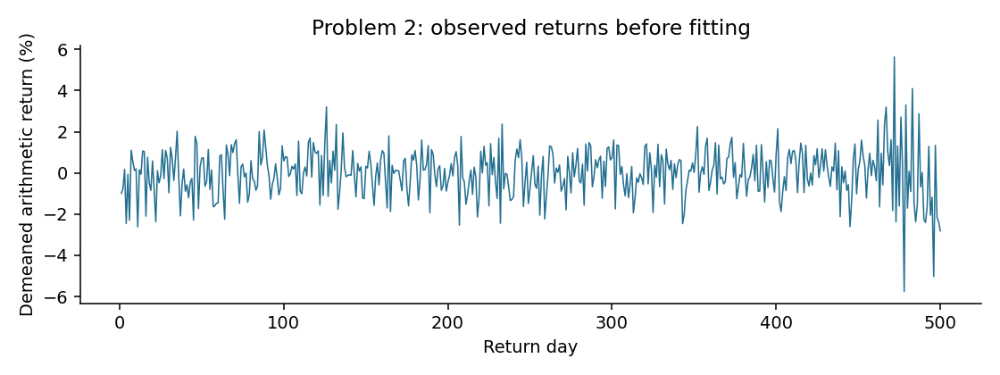
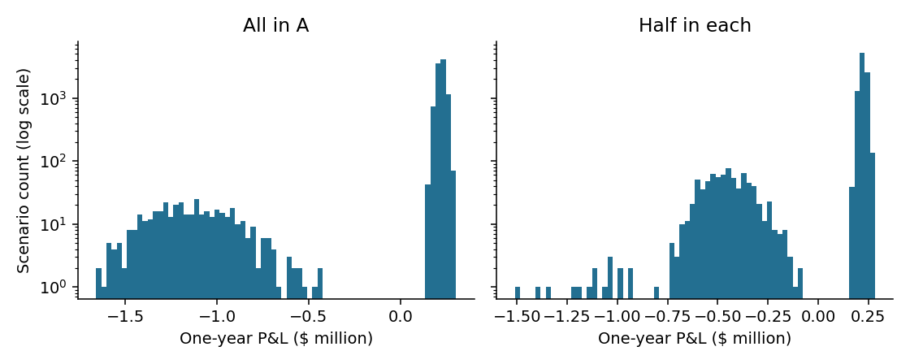
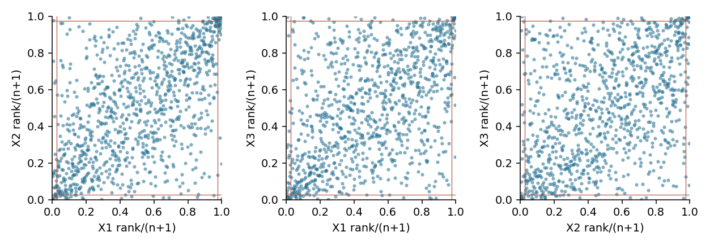

# Assignment 2

Covariance, VaR, and CopulasFinTech 545 - Quantitative Risk ManagementYiting Sun | October 8, 2026

## Conventions and reproducibility

Each problem follows Predict, Fit, and Reconcile. Predictions were recorded in predictions.md after inspecting raw-data summaries and plots, before model fitting. The script prepare.py isolates that inspection step. All five supplied CSV files are included unchanged in data/.

Returns are arithmetic. Descriptive moments use denominator n and report excess kurtosis. Unless stated otherwise, covariance and sample standard deviation use n - 1. VaR is minus the lower P&L quantile; ES is minus the average of the worst alpha fraction. Losses are positive; a negative VaR is a profit at the cutoff, not an absolute-valued loss. Historical quantiles use the empirical inverse CDF, without interpolation. Simulations use 100,000 scenarios and fixed random seeds.

## Problem 1 - Predict (a-c)

The joint-observation table is computed before correlations. Its diagonal gives each series' full observed history; all five are observed together on only 81 days.

| index | A | B | C | D | IDX |
| --- | --- | --- | --- | --- | --- |
| A | 242 | 242 | 221 | 93 | 242 |
| B | 242 | 242 | 221 | 93 | 242 |
| C | 221 | 221 | 228 | 83 | 228 |
| D | 93 | 93 | 83 | 96 | 96 |
| IDX | 242 | 242 | 228 | 96 | 250 |

(a) Complete-case correlation is a standardized Gram matrix on one common sample, so v'Rv is a sum of squared standardized portfolio observations and cannot be negative. It is guaranteed PSD, but can be singular. Pairwise deletion combines entries estimated from different samples and different sample means; there need not be one common Gram matrix. It can therefore be indefinite.

(b) If IDX were exactly the fixed basket, one linear dependence would make the covariance and correlation matrices singular. Small tracking error makes the smallest population eigenvalue close to zero. This leaves little margin for inconsistent pairwise estimates: even a small estimation error can push that eigenvalue below zero.

(c) Correlations involving D should be least reliable because they use only 83-96 joint days. C-D has the fewest, 83. A and B have 242 joint days. These counts describe sampling precision, not a guarantee that the repair will target those entries.

# Problem 1 - Fit: correlation matrices

## (d) Complete-case correlation

| index | A | B | C | D | IDX |
| --- | --- | --- | --- | --- | --- |
| A | 1.00000 | 0.39673 | 0.24662 | 0.41355 | 0.87136 |
| B | 0.39673 | 1.00000 | 0.31689 | 0.23605 | 0.67086 |
| C | 0.24662 | 0.31689 | 1.00000 | 0.18518 | 0.56484 |
| D | 0.41355 | 0.23605 | 0.18518 | 1.00000 | 0.57193 |
| IDX | 0.87136 | 0.67086 | 0.56484 | 0.57193 | 1.00000 |

## (d) Pairwise correlation

| index | A | B | C | D | IDX |
| --- | --- | --- | --- | --- | --- |
| A | 1.00000 | 0.46863 | 0.43089 | 0.43845 | 0.86958 |
| B | 0.46863 | 1.00000 | 0.46302 | 0.27669 | 0.73287 |
| C | 0.43089 | 0.46302 | 1.00000 | 0.18461 | 0.71357 |
| D | 0.43845 | 0.27669 | 0.18461 | 1.00000 | 0.60569 |
| IDX | 0.86958 | 0.73287 | 0.71357 | 0.60569 | 1.00000 |

| Eigenvalue | Complete case | Pairwise |
| --- | --- | --- |
| 1 | 0.001506 | -0.011072 |
| 2 | 0.548345 | 0.471422 |
| 3 | 0.693320 | 0.528367 |
| 4 | 0.870441 | 0.857381 |
| 5 | 2.886388 | 3.153902 |

Ordinary NumPy Cholesky succeeds for the complete-case matrix and fails for the pairwise matrix (not positive definite). The complete-case minimum eigenvalue is 0.001506, while the pairwise minimum is -0.011072. Here complete-case correlation is strictly positive definite; PSD alone would not have guaranteed an ordinary Cholesky factorization.

## (e) Tracking-portfolio variance before repair

In the order A, B, C, D, IDX, let w = (-0.40, -0.30, -0.20, -0.10, 1). Use each series' entire available history for its sample standard deviation, collected in D = diag(s). Then Sigma = D R_pair D and Var(w'r) = w' Sigma w.

| index | A | B | C | D | IDX |
| --- | --- | --- | --- | --- | --- |
| Full-history SD | 0.01650183 | 0.01191893 | 0.01832355 | 0.02282866 | 0.01228141 |

Tracking variance = -1.799370 x 10-6 in squared-return units. It is not a negative dollar loss or a low-risk forecast: it is an invalid variance produced by an inconsistent covariance estimate.

# Problem 1 - Repair and reconcile

## (f) Two repairs, with the same full-history standard deviations

| method | Minimum eigenvalue | Frobenius distance | Tracking variance |
| --- | --- | --- | --- |
| Pairwise | -1.107185e-02 | 0.00000000 | -1.799370e-06 |
| RJ | 1.468910e-16 | 0.01618210 | 6.807298e-07 |
| Higham | -4.260125e-13 | 0.01552000 | 6.787649e-07 |

Rebonato-Jackel clips negative eigenvalues at zero and rescales the result to unit diagonal. Higham alternates projection onto the PSD cone and the unit-diagonal set, with Dykstra's correction, to minimize the unweighted Frobenius distance. Higham converges in 34 iterations at tolerance 10-12. Its -4.26 x 10-13 eigenvalue is numerical zero. A PSD repair can sit on the singular boundary; successful ordinary Cholesky is not its acceptance criterion.

## (g) Why the negative variance is impossible

Positive semidefiniteness means v' Sigma v >= 0 for every real vector v. The tracking weights exhibit a concrete direction that violates this definition. Scaling an indefinite correlation matrix by a positive diagonal does not remove the problem. Both repairs restore a nonnegative tracking variance, about 6.8 x 10-7. This is algebraic consistency, not proof that either repaired estimate is the true covariance.

## (h) Which entries Higham changes most

| pair | Pairwise | Higham | Change | Joint days |
| --- | --- | --- | --- | --- |
| A-IDX | 0.869584 | 0.862540 | -0.007045 | 242 |
| C-IDX | 0.713575 | 0.708810 | -0.004765 | 228 |
| B-IDX | 0.732867 | 0.728687 | -0.004180 | 242 |
| D-IDX | 0.605691 | 0.601964 | -0.003727 | 96 |
| A-C | 0.430888 | 0.433165 | +0.002277 | 221 |

The largest moves involve IDX, especially A-IDX, despite their relatively long histories. C-D, the least-supported pair, moves by only +0.001205. Thus the repair does not follow the reliability ranking in (c). It uses the geometry of the negative-eigenvalue direction and the unit-diagonal constraint. Entries whose adjustment most efficiently restores a feasible joint correlation structure move most. No observation counts or estimation-error weights enter this objective.

## (i) Estimator choice versus repair choice

The complete-case/pairwise Frobenius gap is 0.423935. The two repair sizes are only 0.016182 and 0.015520, and the repaired matrices differ by 0.004579. The estimator gap is about 27 times the Higham repair size. For these data the choice of estimator matters much more than which of these two repairs is used. Complete cases sacrifice substantial history and change the sample period, whereas pairwise deletion uses more data at the price of possible incoherence.

# Problem 2 - Predict from the return history

Figure 1. Five hundred demeaned arithmetic returns; the last roughly 40 days show larger fluctuations.

## (a) Pre-fit ranking

My ascending prediction was historical < fitted t < equal-weight normal < EW normal (0.97) < EW normal (0.94). I expected the recent volatile period to dominate the EW estimators, especially the faster 0.94 estimator. The first three were tentative: full-sample 5% historical and t cutoffs can reflect the old calm regime, while a normal fit spreads the effect of extreme returns across its variance. This original ranking is retained even though the historical estimate turns out differently.

## (b) Effective sample size, half-life and regime weights

I identify the last 40 returns (days 461-500) as an approximate high-volatility regime by visual inspection; this is not an optimized or known structural break. With the newest return assigned lag zero, w_j = (1 - lambda) lambdaj / (1 - lambda500). Then n_eff = 1 / sum(w_j2), half-life = log(0.5) / log(lambda), and recent-40 weight = (1 - lambda40) / (1 - lambda500).

| lam | Effective n | Half-life (days) | Recent 40 weight |
| --- | --- | --- | --- |
| 0.970000 | 65.667 | 22.757 | 0.7043 |
| 0.940000 | 32.333 | 11.202 | 0.9158 |

The same 40 observations receive only 8% under equal weighting, compared with 70.43% at 0.97 and 91.58% at 0.94. The infinite-history effective-n approximation (1 + lambda)/(1 - lambda) is practically identical here.

## (c) First four moments and the normal-regime prediction

| index | mean | variance | skewness | excess_kurtosis |
| --- | --- | --- | --- | --- |
| Return | -2.220e-19 | 0.00014161 | -0.155587 | 2.132367 |

Excess kurtosis is 2.132, whereas a normal population has zero; skewness is only -0.156. A finite normal sample can produce nonzero kurtosis, but this magnitude and the visible time clustering make one stable normal regime unconvincing. A mixture of calm and volatile periods can create heavy unconditional tails even if each regime is approximately normal. The raw mean removed from returns is 0.000161876 per day.

# Problem 2 - Fit and reconcile

## (d) Five one-day VaR estimates on $1,000,000

| method | VaR ($) |
| --- | --- |
| Normal equal | 19,593.66 |
| Normal EW 0.97 | 34,619.08 |
| Normal EW 0.94 | 38,707.38 |
| Student t | 18,872.45 |
| Historical | 20,574.46 |

The fitted Student t has df = 8.269950, location = 0.000181622, and scale = 0.010289993. Scale is not its standard deviation. All three parameters are fitted by maximum likelihood; removing the sample mean does not force the t location to zero. Normal VaR uses zero mean and sample SD; EW variance uses normalized weighted squared demeaned returns without a Bessel correction.

## (e) Actual order and the missed feature

The actual order is t < equal-weight normal < historical < EW 0.97 < EW 0.94. The recent-volatility prediction was correct, but historical VaR was not the smallest. A 5% quantile depends on the location of the 25th worst return, not only on how many extraordinary events occur. Moderate losses and recent large losses together place it below the normal and t cutoffs. A heavy-tailed fitted t also need not have a larger 5% VaR: its estimated center and scale can give a narrower moderate quantile while leaving more probability in the far tails.

## (f) Within-regime volatility explains pooled kurtosis

| regime | Days | Sample SD | Excess kurtosis |
| --- | --- | --- | --- |
| Days 1-460 | 460 | 0.010178 | -0.213089 |
| Days 461-500 | 40 | 0.024289 | -0.119871 |

Volatility rises from 1.018% to 2.429%, about 2.39 times larger, while excess kurtosis within the two visual regimes is close to zero. For zero-mean normal regimes with weights p_j, pooled excess kurtosis is 3 sum(p_j sigma_j4) / [sum(p_j sigma_j2)]2 - 3. Substituting the two within-regime variances gives about 2.469, broadly explaining the observed 2.132. The comparison is approximate because the finite sample has different regime means and moments. The single fitted t describes the pooled mixture, not tomorrow's conditional volatility or evidence of one permanent t regime.

## (g) EW estimation noise and an explicitly subjective choice

| lam | Approx. SD SE | Approx. VaR SE ($) |
| --- | --- | --- |
| 0.970000 | 0.001837 | 3,021 |
| 0.940000 | 0.002926 | 4,813 |

The EW VaR gap is $4,088. Its corresponding volatility gap is 0.002486. This exceeds the 0.97 estimator's one-SE scale ($3,021), but is smaller than the 0.94 estimator's ($4,813); it is not overwhelmingly larger than estimation noise. A naive independent-error combination is $5,683, but these two estimators use the same observations and are correlated, so that is not a valid significance test. The Week 3 formula itself is only a stationary approximation after a regime shift.

Opinion: I would use 0.94 for a trading limit to respond quickly to the persistent increase. I would use 0.97 for a more stable capital number, supplemented by stress scenarios. Its lower estimate can lag a new regime; stability alone does not make it conservative.

# Problem 3 - Predict and fit at 5%

Figure 2. Annual P&L distributions. A log count scale makes the low-probability default clusters visible.

## (a) First four bond-return moments

| index | mean | variance | skewness | excess_kurtosis |
| --- | --- | --- | --- | --- |
| A | 0.083709 | 0.018491 | -4.8225 | 22.0820 |
| B | 0.085011 | 0.017449 | -4.9148 | 23.0744 |

Each distribution has strongly negative skewness and excess kurtosis above 22. Most scenarios are near the non-default payoff return (100/90 - 1 = 11.11%), while a small cluster contains large default losses. A normal model cannot preserve that separation and its 5% cutoff can fall in a low-density gap. Mean and variance alone miss the default-threshold mechanism.

## (b) Prediction from severe-loss counts, before risk calculations

A loses more than 20% in 406/10,000 scenarios (4.06%); B does so in 393 (3.93%). At least one does so in 782 (7.82%), with 17 joint events (0.17%). Thus 765 scenarios have exactly one severe loss. The concentrated 5% cutoff should remain outside the default cluster; the diversified cutoff should enter it. I predict higher diversified 5% VaR but lower ES: more scenarios contain a loss, but almost all default events expose only half the capital. Counts identify the threshold crossing; the P&L plot also supports the loss-severity prediction for ES.

## (c-d) Historical risk and normal VaR, alpha = 5%

| position | Historical VaR ($) | Historical ES ($) | Normal VaR ($) |
| --- | --- | --- | --- |
| A $1m | -84,531 | 443,628 | 139,971 |
| B $1m | -86,011 | 419,587 | 132,277 |
| A $2m | -169,061 | 887,257 | 279,941 |
| A+B $2m | 414,767 | 541,997 | 143,466 |

Normal VaR is -mean(P&L) + 1.644854 SD(P&L), using each position's sample P&L moments. Historical ES averages the worst 500 scenarios. A negative historical VaR for either single bond means that the 5% lower P&L quantile is still a profit; it must not be reported as a positive loss by taking an absolute value.

# Problem 3 - Reconcile and change the tail level

## (e) Historical results at alpha = 1%

| position | VaR ($) | ES ($) |
| --- | --- | --- |
| A $1m | 650,545 | 709,548 |
| B $1m | 641,248 | 700,805 |
| A $2m | 1,301,090 | 1,419,096 |
| A+B $2m | 598,237 | 716,408 |

## (f) Explicit subadditivity checks at 5%

VaR(A) + VaR(B) = $-84,531 + $-86,011 = $-170,542, but VaR(A+B) = $414,767. The required inequality VaR(A+B) <= VaR(A) + VaR(B) fails by $585,309. This is a direct subadditivity violation, separate from comparing the two equal-capital choices.

ES(A) + ES(B) = $443,628 + $419,587 = $863,216, whereas ES(A+B) = $541,997. ES is subadditive here, with a margin of $321,218. Compared with putting all $2 million in A, diversification lowers ES from $887,257 to $541,997, while increasing VaR from $-169,061 to $414,767.

The mechanism is the 5% cutoff crossing a gap between repayment and default outcomes. Each bond individually defaults less often than 5%, so its VaR misses the default cluster. Combining two mostly different default sets pushes the event probability above 5%, pulling the portfolio cutoff into that cluster. ES includes the severity of the whole worst 5% in both choices, and benefits when the severe exposures do not coincide.

## (g) Is the normal answer right for the right reason?

Normal VaR favors the $1 million/$1 million split: $143,466 versus $279,941 for $2 million in A. The sample bond-return correlation is only 0.00220, so diversification really does lower variance and historical ES. In that broad severity sense the preference is sensible. But for the specified historical 5% VaR it gives the opposite ordering. A normal approximation smooths the separated payoff clusters into one bell curve; it cannot explain the actual quantile crossing. Thus it is not right for the right reason if the objective is 5% VaR.

## (h) Why 1% VaR behaves differently

At 1%, both the concentrated and diversified cutoffs are already inside default outcomes. Diversified VaR is $598,237 versus $1,301,090 for all in A, so diversification now lowers VaR. Also VaR(A+B) = $598,237 < $1,291,793 = VaR(A) + VaR(B): subadditivity holds for these positions at this level. Joint severe losses occur in only 0.17% of scenarios, below 1%, so the 1% diversified cutoff is still largely a one-default outcome. VaR's failure depends on the tail level, event probabilities and payoff geometry; it does not have to fail at every alpha. ES remains subadditive at 1%.

# Problem 4 - Predict margins and dependence

## (a) Moments and a single-observation sensitivity check

| index | mean | variance | skewness | excess_kurtosis |
| --- | --- | --- | --- | --- |
| X1 | 0.000257 | 0.0001413 | -0.0342 | -0.1225 |
| X2 | -0.000252 | 0.0002612 | -0.6141 | 7.0834 |
| X3 | 0.000890 | 0.0001003 | 0.0740 | 2.8537 |

The moment-based prediction is normal for X1, t for X2 and X3. X1 has near-zero skew and modest negative excess kurtosis; X2 and X3 have substantial excess kurtosis. X2's negative skew initially looks incompatible with a symmetric t, so I check its largest absolute deviation from the median.

| asset | Removed day | Removed return | New skewness | New excess kurtosis |
| --- | --- | --- | --- | --- |
| X1 | 952 | -0.040000 | -0.0055 | -0.1927 |
| X2 | 952 | -0.142914 | 0.0558 | 1.7101 |
| X3 | 952 | -0.061244 | 0.3127 | 1.7161 |

Day 952 is extreme in all three series. Removing it changes X2's skewness from -0.614 to +0.056 and excess kurtosis from 7.083 to 1.710. Negative skew is therefore highly sensitive to that day, while some heavy-tailed shape remains. This is a diagnostic only: all observations are retained in every fit.

## (b) Rank plots and simultaneous tails

Figure 3. Rank/(n+1) keeps empirical uniforms strictly inside (0,1); reference lines mark marginal 2.5% tails.

| pair | lower | upper |
| --- | --- | --- |
| X1-X2 | 6 | 8 |
| X1-X3 | 7 | 12 |
| X2-X3 | 6 | 9 |

Under independence the expected count in either joint tail is 1,000 x 0.0252 = 0.625 days per pair. Observed counts of 6-12 and concentrated corners suggest stronger tail association than a loose central cloud. I predict the t copula wins. Positive Gaussian correlation itself raises counts above independence, so the independence comparison is suggestive rather than a test that uniquely establishes a t copula.

# Problem 4 - Fit margins and copulas

## (c) Maximum-likelihood margins and AICc

| asset | model | df | loc | scale | AICc |
| --- | --- | --- | --- | --- | --- |
| X1 | Normal |  | 0.0002566 | 0.0118882 | -6022.537 |
| X1 | Student t | normal limit | 0.0002566 | 0.0118882 | -6020.524 |
| X2 | Normal |  | -0.0002524 | 0.0161604 | -5408.494 |
| X2 | Student t | 5.2715 | -0.0001760 | 0.0125440 | -5518.185 |
| X3 | Normal |  | 0.0008898 | 0.0100138 | -6365.691 |
| X3 | Student t | 6.0949 | 0.0007456 | 0.0081808 | -6428.016 |

AICc = -2 log L + 2k + 2k(k+1)/(n-k-1), with k = 2 for a normal margin and k = 3 for a t margin. The choices agree with the prediction: normal X1, t X2, t X3. X1's t likelihood approaches the normal limit at very large degrees of freedom and does not earn its extra parameter. X2 and X3 improve AICc by about 109.69 and 62.32, respectively. All locations are estimated, and every scale is the distribution scale, not necessarily its SD.

## (d) Fitted uniforms and a common Kendall correlation matrix

Transform each observed return with its selected fitted CDF: U_ij = F_j(r_ij). Estimate each Kendall tau on the original observations, then set R_ij = sin(pi tau_ij / 2). Monotone marginal transformations preserve these ranks. R is already positive definite; no repair is required.

| index | X1 | X2 | X3 |
| --- | --- | --- | --- |
| X1 | 1.000000 | 0.583263 | 0.502851 |
| X2 | 0.583263 | 1.000000 | 0.464383 |
| X3 | 0.502851 | 0.464383 | 1.000000 |

| model | df | k | Log likelihood | AICc | BIC |
| --- | --- | --- | --- | --- | --- |
| Gaussian | inf | 0 | 350.4403 | -700.8806 | -700.8806 |
| Student t | 3.65993 | 1 | 451.9994 | -901.9949 | -897.0911 |

The Gaussian copula density is the multivariate normal density of z_j = Phi-1(u_j), divided by the product of univariate normal densities. For the t copula, replace both densities and inverse CDFs by t versions with common df. I sum log densities and optimize the t df by a one-dimensional search, with a log-spaced grid check. The fitted df is 3.65993.

As instructed in Week 5, margins and Kendall R are frozen for this comparison, so the remaining parameter counts are k_Gauss = 0 and k_t = 1. These are conditional copula information criteria, not full joint marginal-plus-copula likelihood scores. Counting the three R entries as newly fitted parameters would be a different convention; it is not the one used here.

## (g) Which model wins?

The t copula gains 101.5592 log-likelihood units. Its AICc is lower by 201.1143 and BIC by 196.2106. Both strongly favor t, in agreement with the pre-fit prediction. This is an in-sample model comparison under the chosen margins, not a guarantee about future tail calibration.

# Problem 4 - Simulated and historical portfolio risk

## (e) 100,000 scenarios per copula; $1 million in each asset

| model | Tail level | VaR ($) | ES ($) |
| --- | --- | --- | --- |
| Gaussian | 5% | 49,991 | 66,760 |
| Gaussian | 1% | 76,449 | 94,448 |
| Student t | 5% | 49,434 | 68,623 |
| Student t | 1% | 79,906 | 101,938 |
| Historical | 5% | 47,939 | 65,699 |
| Historical | 1% | 70,092 | 102,424 |

For Gaussian simulation, draw correlated normal scores and apply Phi. For t simulation, divide the same correlated normal scores by one shared sqrt(chi-square(df)/df) per day, then apply the t CDF. Apply each fitted marginal inverse CDF to those uniforms and sum the three dollar P&Ls. Sharing the scale within a t scenario is essential for tail dependence. Marginal means are retained because this problem does not impose zero expected returns.

## (f-g) Implied joint tail days per 1,000 days

| Pair | Data low | Data high | Gauss low | Gauss high | t low | t high |
| --- | --- | --- | --- | --- | --- | --- |
| X1-X2 | 6 | 8 | 5.95 | 6.07 | 9.58 | 9.50 |
| X1-X3 | 7 | 12 | 4.57 | 4.59 | 8.01 | 8.24 |
| X2-X3 | 6 | 9 | 4.20 | 4.19 | 7.60 | 7.53 |

Counts use true simulated marginal uniforms below 0.025 or above 0.975, then multiply scenario frequencies by 1,000. They are expected counts, not rounded actual days. The t copula predicts about 7.5-9.6 joint-tail days; Gaussian predicts about 4.2-6.1. The t model generally better captures the larger observed counts, especially upper tails, but overpredicts some lower counts and misses the X1-X3 upper count of 12. Both copulas are symmetric, so they cannot systematically fit lower/upper asymmetry. One thousand observations leave these rare-event counts noisy.

## (h) Which risk number changes most?

| Measure | t minus Gaussian ($) | Change (%) |
| --- | --- | --- |
| 5% VaR | -557 | -1.11 |
| 5% ES | +1,863 | +2.79 |
| 1% VaR | +3,457 | +4.52 |
| 1% ES | +7,490 | +7.93 |

The biggest move is 1% ES, up about $7,490 (7.93%). A common t scale increases the chance of simultaneous extreme marginal losses, reducing diversification precisely in the deepest tail. ES averages their magnitudes rather than just locating a cutoff. The 5% VaR barely moves because margins and central rank association are fixed, and that moderate quantile is less sensitive to the extreme joint tail. Tail dependence does not imply every finite-level VaR must rise monotonically.

# Problem 4 - What the likelihood gain is scoring

## (i) Daily log-likelihood contributions

For every day I compute d_i = log c_t(U_i; R, df) - log c_Gauss(U_i; R). All 1,000 daily values are saved in tables/p4_daily_likelihood.csv. The main definition of a central day uses empirical ranks: all three series must lie strictly inside their own 5th-95th percentile range. This matches the question's description of observations sitting outside their own marginal tails.

| index | Days | Log-likelihood gain | Share (%) |
| --- | --- | --- | --- |
| All margins central | 784 | 49.8003 | 49.04 |
| At least one outer-5% | 216 | 51.7588 | 50.96 |
| Total | 1000 | 101.5592 | 100.00 |

49.04% of the net likelihood improvement comes from the 784 days when no asset is in either outer 5% tail. The rest comes from the 216 days with at least one tail observation; those need not be joint tail days. As a sensitivity, defining central days by fitted uniforms instead yields 793 days and a gain of 50.4780, leading to the same conclusion.

Information criteria score the entire joint density, not only joint crashes. The t copula changes central concentration and the distribution of moderate co-movements as well as asymptotic tail dependence. Its strong AICc/BIC advantage therefore cannot be interpreted as 101.56 units of evidence coming only from extreme-tail events. Some daily contributions can be negative; these reported shares are contributions to the net gain, not proportions of days that favor t.

## (j) Tail dependence for the most correlated pair

The largest fitted correlation is X1-X2, rho = 0.583263. For a t copula, the lower and upper tail-dependence coefficients are identical:

lambda_L = lambda_U = 2 T_(df+1)(-sqrt[(df+1)(1-rho)/(1+rho)]).

At df = 3.65993, this gives 0.321942. It is the limiting conditional probability that one variable is in an ever more extreme tail given the other is in the same tail. The Gaussian copula coefficient is zero because rho is strictly less than one. Zero asymptotic dependence does not mean independent returns or zero finite-2.5% co-exceedances.

## Monte Carlo precision and finite historical tails

| Copula | Tail level | VaR MC SE ($) | ES MC SE ($) |
| --- | --- | --- | --- |
| Gaussian | 5% | 235 | 257 |
| Gaussian | 1% | 475 | 855 |
| Student t | 5% | 249 | 268 |
| Student t | 1% | 368 | 924 |

These are rough standard errors of a full 100,000-scenario estimate, using ten independent batches and dividing their standard deviation by sqrt(10). They quantify simulation noise only, not parameter or model uncertainty. The historical 1% ES averages just ten days and includes day 952, so its close agreement with the t estimate should not be treated as precise validation. Common random normal draws reduce some comparison noise, but the two copulas still have different random scale structures.

# Problem 5 - Predict and fit the factor models

## (a) Prediction from the portfolio variance formula

Write r_A = alpha_A + beta_A r_M + epsilon_A and likewise for B, with the market uncorrelated with the regression errors. Let c = Cov(epsilon_A, epsilon_B). An omitted shared industry factor suggests c > 0. In dollar units, the residual part of P1 variance is 1012(s_A2 + s_B2 + 2c), whereas P2 uses 1012(s_A2 + s_B2 - 2c).

Setting c to zero should therefore understate P1 VaR and overstate P2 VaR. Under zero-mean normal P&L, VaR is proportional to SD, so the variance direction is the VaR direction. I expect P2 to be more sensitive in percentage terms because similar market betas largely cancel in a long-short position, leaving residual differences as its main risk.

## (b) OLS regression on 500 arithmetic returns

| Stock | Intercept alpha | Market beta | Residual SD (n-1) | Residual SD (n-2) |
| --- | --- | --- | --- | --- |
| A | 0.000205013 | 1.035278 | 0.01288830 | 0.01290123 |
| B | 0.000314773 | 0.935417 | 0.01153844 | 0.01155002 |

The market sample SD is 0.01055272; the residual correlation is 0.698307. This strong positive residual association confirms that the market alone leaves substantial shared movement unexplained. It is consistent with a shared omitted factor, though the data do not identify that factor as an industry effect.

## Residual covariance used for simulation

| index | A | B |
| --- | --- | --- |
| A | 0.000166108 | 0.000103846 |
| B | 0.000103846 | 0.000133136 |

I use denominator n - 1 for the market variance, sample stock covariance and covariance of the centered OLS residuals. This common convention gives an exact sample covariance decomposition. The n - 2 residual SDs shown above are the usual regression-error estimates with two fitted coefficients; they are not mixed with n - 1 covariances in the simulation. That choice is explicit because inconsistent degrees-of-freedom corrections can create a small artificial mismatch.

## Zero expected returns and the simulation construction

I report the fitted alphas, but omit them from simulated returns to honor the instruction to assume zero expected returns. Draw independent zero-mean market and bivariate residual vectors; use either the full residual covariance or its diagonal. Form simulated stock returns as beta_i r_M + epsilon_i. A shared random market and common base normal residual draws are used for the two assumptions to reduce comparison noise.

# Problem 5 - Portfolio VaR and reconciliation

## (c-d) 100,000 simulated days and direct delta-normal VaR

| Residual assumption | Portfolio | Simulated VaR ($) | Model formula ($) | Delta-normal ($) | MC SE ($) |
| --- | --- | --- | --- | --- | --- |
| Full residuals | P1 | 50,412 | 50,415 | 50,415 | 232 |
| Full residuals | P2 | 15,892 | 15,834 | 15,834 | 62 |
| Independent | P1 | 44,358 | 44,494 | 50,415 | 136 |
| Independent | P2 | 28,694 | 28,507 | 15,834 | 147 |

The model formula uses Sigma_model = beta beta' Var(r_M) + Sigma_e and VaR = 1.644854 sqrt(w' Sigma_model w). Direct delta-normal VaR uses the stock-return sample covariance instead. Both use zero mean and alpha = 5%. MC SE is the same ten-batch approximation as in Problem 4. Differences of tens or hundreds of dollars between simulated and analytical answers are consistent with Monte Carlo noise.

## (e) Direction and size of the omitted-correlation effect

Both predictions are confirmed. Using analytical values to remove simulation noise, the shortcut reduces P1 VaR by $5,921 (11.74%), but raises P2 VaR by $12,673 (80.04%). P2 is much more exposed in relative terms. Its market loading is beta_A - beta_B = 0.099861 versus beta_A + beta_B = 1.970695 for P1. Ignoring positively correlated residuals discards the long-short hedge that cancels shared shocks.

## (f) Why full residual simulation agrees with delta-normal

With an intercept, OLS makes each residual vector orthogonal to the observed market vector and to the constant. Thus, on the same rows and with consistent covariance divisors, S_stocks = beta beta' s_M2 + S_residuals exactly. In this calculation the maximum entrywise discrepancy is 1.63 x 10-19. This covariance identity is an OLS algebra result; normality is not needed for the identity itself.

Under the imposed joint normal model, zero covariance between the market and residuals also implies independence. A sum of these normal components is multivariate normal with precisely the stock sample covariance. Any linear portfolio therefore has the same normal distribution, and consequently the same theoretical VaR, under full residual simulation and delta-normal. The displayed small simulation differences vanish as the number of draws grows.

Agreement can fail if residual correlation is dropped, different windows or EW weights are used, covariance divisors differ, or alphas are added to only one model. With non-normal residuals, nonlinear factor relationships, or nonlinear portfolio payoffs, matching covariance no longer ensures matching tail quantiles. In a non-normal model OLS orthogonality also need not imply independence; independently simulating market and residuals may then destroy dependence that matters for VaR.

## Source and reproduction notes

Problem statements and input data: class/Assignments/Assignment2/assignment.qmd and problem1.csv through problem5.csv. Methods and conventions follow the local Week 2-5 course materials, especially Week 3 exponential weighting/PSD repair and Week 5 copula comparison/OLS. No market data or external estimates were added. Run analysis.py, then build_report.py; README.md gives the complete setup commands.
